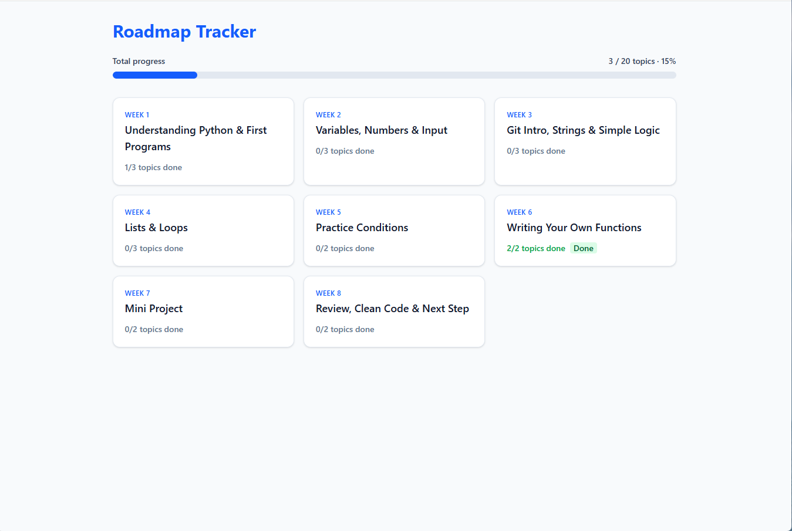

# Roadmap Tracker

A small Next.js app for working through an 8-week learning roadmap: tick off topics week by week and track your overall progress.

**Live demo:** https://roadmap-tracker-navy-five.vercel.app/



## Features

- **Overview with total progress:** a progress bar for all topics, plus a card per week showing "x/y topics done".
- **Week pages:** each week has its own page (`/week/1` … `/week/8`) with a checklist of its topics. Unknown weeks (e.g. `/week/99`) return a 404 page.
- **Done badge:** a week shows a "Done" badge once all of its topics are checked.
- **Progress saved in localStorage:** progress survives reloads and stays in sync across open tabs. No account or backend.
- **Keyboard accessible:** week cards are links and topics are native checkboxes with labels, so everything works with Tab, Enter and Space.

## Tech stack

- [Next.js](https://nextjs.org/) 16 (App Router)
- React 19
- TypeScript
- Tailwind CSS v4
- Jest + React Testing Library (unit and component tests)
- Playwright (end-to-end tests)

## Technical decisions

- **Server Components by default.** The pages, the root layout and `WeekCard` are Server Components. Only three small components use `"use client"`, the ones that read or change progress: `TotalProgress`, `WeekProgress` and `TopicChecklist`. All 8 week pages are pre-rendered at build time with `generateStaticParams`.
- **`useSyncExternalStore` for localStorage.** The `useProgress` hook treats localStorage as an external store. On the server and during hydration it returns empty progress, then switches to the saved progress in the browser. This avoids hydration mismatches without needing `useEffect` + `setState`. Corrupt or blocked storage falls back to empty progress.
- **Accessible markup, tested by role.** The progress bar uses `role="progressbar"` with `aria-valuenow`, and checkboxes are labelled. Tests query elements by role, label and text (`getByRole`, `getByLabel`, `getByText`), so they also check that the UI is accessible.

## Testing

**Unit and component tests** (Jest + React Testing Library, next to the code in `src/`):

- `calculateProgress`: counting done/total topics, including edge cases (nothing done, `false` entries, unrelated ids, no weeks).
- Overview page: renders a linked card for every week, the progress bar at 0%, and no checkboxes.
- `TopicChecklist` + `WeekProgress`: checking topics with mouse and keyboard, the Done badge appearing and disappearing, and saving to localStorage. Each test starts from a clean store.

**End-to-end tests** (Playwright, in `e2e/`, on Desktop Chrome and a Pixel 7 viewport) run against a production build:

- Overview shows all weeks and a progress bar at 0%.
- Clicking a week card opens its week page.
- Checking topics (by click and with Space) updates the week and total progress.
- Progress survives a page reload.
- `/week/99` shows the not-found page.
- Completing a week shows "Done" on only that week's card.

```bash
npm test                        # unit + component tests
npx playwright install chromium # once, to download the browser
npm run test:e2e                # E2E tests (builds and starts the app on port 3000)
npm run test:e2e:ui             # E2E tests in Playwright's UI mode
```

Locally, the E2E tests reuse a server that is already running on port 3000.

## Getting started

Requires Node.js 20.9 or newer.

```bash
npm install
npm run dev     # http://localhost:3000
```

| Script                | What it does                         |
| --------------------- | ------------------------------------ |
| `npm run dev`         | Start the development server         |
| `npm run build`       | Create a production build            |
| `npm run start`       | Serve the production build           |
| `npm run lint`        | Run ESLint                           |
| `npm test`            | Run Jest unit and component tests    |
| `npm run test:e2e`    | Run Playwright E2E tests             |
| `npm run test:e2e:ui` | Run Playwright tests in UI mode      |

The roadmap content lives in [`src/data/roadmap.ts`](src/data/roadmap.ts).
